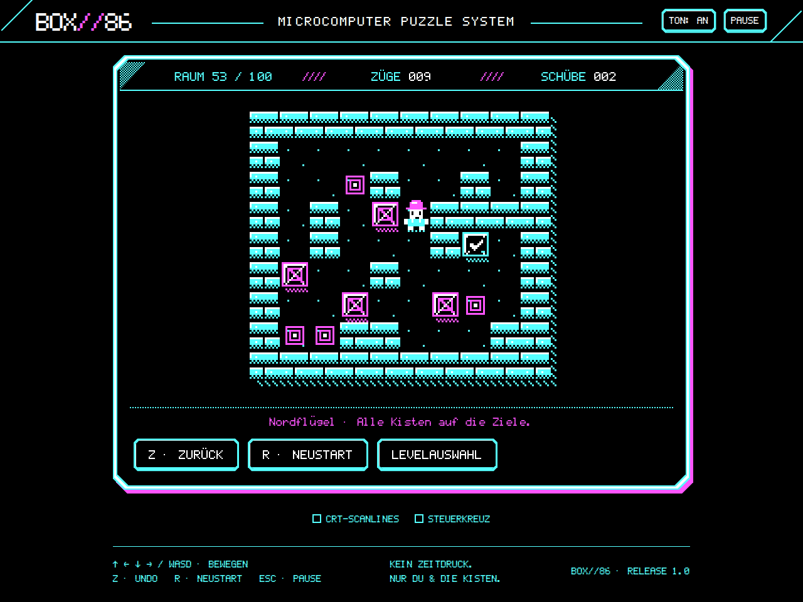
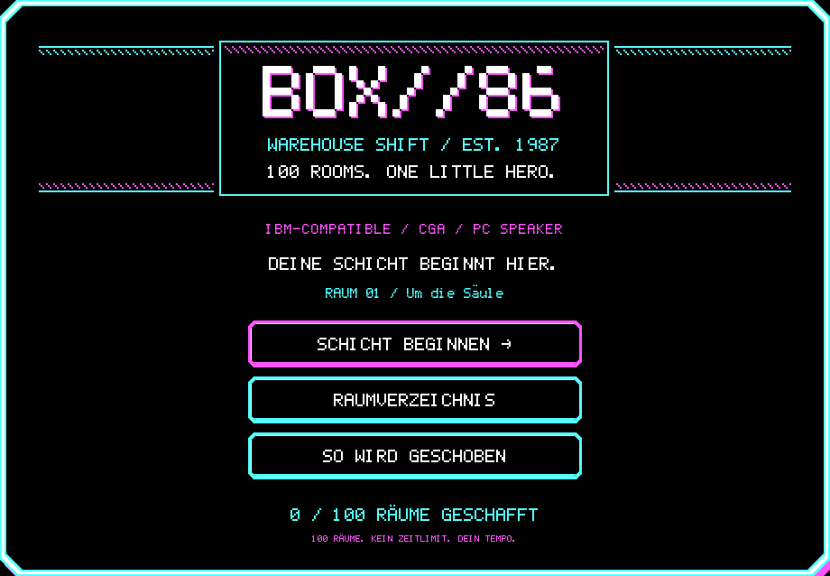
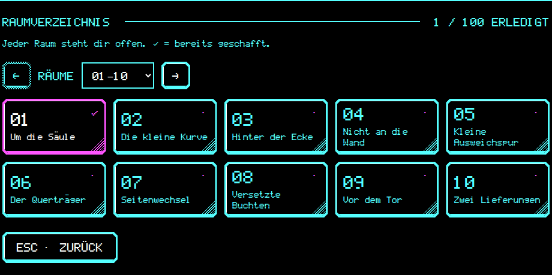
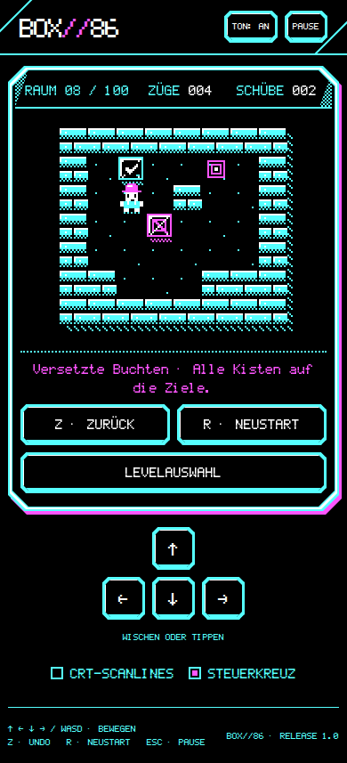

# BOX//86

Ein kleines Lager voller Kopfarbeit: BOX//86 ist ein Sokoban-Spiel im Stil eines IBM-PC-Spiels von 1987. 100 kompakte Rätsel, eigene CGA-Pixelgrafik, kurze Animationen und zurückhaltender PC-Speaker-Sound. Ohne Werbung, Tracking, Konten oder Zeitdruck.

**100 geprüfte Levels · CGA-Pixelgrafik · Tastatur & Touch · Unbegrenztes Undo**

<p align="center">
  <a href="docs/screenshots/desktop.png">
    
  </a>
</p>

<details>
<summary><strong>Mehr Screenshots: Titelmenü, Levelauswahl und Smartphone</strong></summary>

### Willkommen zur Schicht

Das Hauptmenü führt direkt zum Spiel, zum Raumverzeichnis oder zur kurzen Einweisung. Während einer Pause bleibt der laufende Versuch erhalten.

<p align="center">
  <a href="docs/screenshots/title.png">
    
  </a>
</p>

### Alle Räume stehen offen

Alle 100 Levels sind direkt anwählbar. Magenta markiert den aktuellen Raum, ein Häkchen einen abgeschlossenen Raum.

<p align="center">
  <a href="docs/screenshots/levels.png">
    
  </a>
</p>

### Auch für unterwegs

Auf dem Smartphone steuerst du per Wischgeste oder mit dem einblendbaren Steuerkreuz. Undo, Neustart, Pause und Mute bleiben direkt erreichbar.

<p align="center">
  <a href="docs/screenshots/mobile.png">
    
  </a>
</p>

</details>

## Start

Node.js 20.19+ oder 22.12+ vorausgesetzt.

```sh
npm install
npm run dev
```

Die angezeigte lokale Adresse öffnen. Für die Veröffentlichung:

```sh
npm run build
npm run preview
```

Den **Inhalt von `dist/`** auf einen statischen Webserver kopieren, etwa GitHub Pages. Relative Asset-URLs unterstützen sowohl eine Domainwurzel als auch ein Unterverzeichnis. Das Spiel braucht weder Node.js auf dem Webserver noch eine Datenbank, externe APIs oder Serverkomponenten. Generator, Solver und Testwerkzeuge werden nicht ausgeliefert. Es gibt keine Service-Worker-Installation und keinen automatischen Offline-Cache.

## Bedienung

Das Titelmenü bietet „Schicht beginnen“, Raumverzeichnis und eine kurze Einweisung. Alle 100 Räume sind ohne Freischaltung anwählbar; die Auswahl zeigt zehn Räume pro Gruppe und markiert aktuelle/abgeschlossene Räume.

| Eingabe | Aktion |
| --- | --- |
| Pfeiltasten / WASD | Figur bewegen |
| Z / Zurück | Unbegrenzt Schritte des aktuellen Versuchs zurücknehmen |
| R / Neustart | Raum und Zähler zurücksetzen |
| Esc / P / Pause-Button | Hauptmenü öffnen; derselbe Versuch bleibt im Speicher |
| Weiterspielen | Pausierten Versuch fortsetzen |
| M / Ton-Button im Header | Alle Effekte sofort stummschalten oder aktivieren |
| Wischgeste auf dem Spielfeld | Ein Zug in Wischrichtung; kurze oder unklare diagonale Gesten werden ignoriert |
| Bildschirm-Steuerkreuz | Bewegen durch Antippen; auf Touch-Geräten zunächst eingeblendet |
| Tab / Shift+Tab / Enter | Menüs und Buttons bedienen |
| Menü: ↑ / ↓ | Menüpunkt auswählen |
| Raumverzeichnis: Pfeiltasten, Pos1 / Ende | Kachel auswählen |
| Raumverzeichnis: Bild ↑ / ↓ | Levelgruppe wechseln |

Kisten lassen sich nur einzeln schieben, nicht ziehen. Alle magentafarbenen Ziele müssen belegt werden. Eine richtig platzierte Kiste wird cyan und bekommt ein Häkchen. Nach dem kurzen Abschluss-Effekt führt „Weiter“ zum nächsten Raum.

Lauf-, Schub-, Menü- und Abschlussklänge werden lokal mit der Web Audio API erzeugt, erst nach einer Bedienaktion. Es gibt keine Dauermusik. Der jederzeit erreichbare Ton-Schalter bleibt gespeichert; falls Audio nicht verfügbar ist, läuft das Spiel geräuschlos weiter.

CRT-Scanlines sind zunächst ausgeschaltet. Im Haupt-/Pausemenü lassen sich CRT-Effekt und Steuerkreuz umschalten; im Hochformat auch direkt unter dem Spiel. Während einer Wischgeste bleibt das Spielfeld fest, außerhalb des Spielfelds kann die Seite normal gescrollt werden. Im Querformat stehen Spielfeld und eingeblendete Touch-Steuerung nebeneinander.

Die 90–120 ms kurzen Bewegungen, der Abschluss-Effekt und der Levelübergang sperren zusätzliche Spielzüge; Eingaben werden nicht aufgestaut. Pause kann den Effekt jederzeit beenden. `prefers-reduced-motion: reduce` deaktiviert alle Bewegungs- und Übergangseffekte sofort.

Bestwerte für Züge und Schübe sind **getrennte Minima**, möglicherweise aus verschiedenen Versuchen. Sie stehen im aktuellen Raum und im Tooltip seiner Kachel. **Ein Menüwechsel behält den laufenden Versuch samt Undo-Verlauf; ein Browser-Reload startet den zuletzt gewählten Raum neu.** Einstellungen, Abschlüsse und Bestwerte bleiben dabei erhalten.

## Levels und Fortschritt

Das Levelpaket `warehouse-100-v1` enthält genau 100 Räume mit stabilen IDs `"1"` bis `"100"`. Die ersten 15 Räume sind gezielt gestaltet, die weiteren 85 aus 340 unabhängig geprüften Kandidaten ausgewählt. Kein fremdes Levelpaket wurde verwendet.

| Räume | Einordnung | Schuboptimum |
| --- | --- | --- |
| 1–5 | Sehr einfach | 3–5 |
| 6–15 | Einfach | 5–9 |
| 16–30 | Leicht bis mittel | 8–12 |
| 31–60 | Mittel | 8–14 |
| 61–85 | Mittel bis knifflig | 10–15 |
| 86–100 | Anspruchsvoller | 12–21 |

Unter `box86.progress` speichert localStorage Schema 2 mit `levelPackId`, `lastLevel`, `completed` und allgemeinen `settings`. Ein Abschluss enthält `bestMoves` und `bestPushes`. Schlechtere Ergebnisse überschreiben keine Minima. Die Einstellungen `muted`, `scanlines` und `showControls` werden im selben Format ergänzt. Die Paketkennung verhindert, dass Ergebnisse eines anderen Levelpakets übernommen werden; allgemeine Einstellungen bleiben davon unabhängig. Laufende Versuche werden nicht dauerhaft gespeichert.

Beim Wechsel vom alten Schema/Paket werden ausschließlich levelbezogene Ergebnisse zurückgesetzt. Allgemeine primitive Einstellungen bleiben erhalten, andere localStorage-Schlüssel werden nicht angefasst. Die Migration wird beim Start dauerhaft gespeichert. Fehlerhafte Einträge werden verworfen; blockierter Speicher verhindert das Spielen nicht. Beim späteren Austausch der Rätsel die Paketkennung ändern; IDs innerhalb eines veröffentlichten Pakets nicht neu zuordnen.

## Architektur und Levelformat

`src/game.ts` enthält Parser und Spielregeln, `levels.json` die statischen Daten, `storage.ts` die Persistenz, `render.ts` die Pixelgrafik, `motion.ts` die Animation und Wischrichtung, `audio.ts` die synthetischen Klänge und `main.ts` die Bedienung. Entwicklungswerkzeuge liegen getrennt unter `tools/levels/`.

Levels sind rechteckige ASCII-Karten mit geschlossenem Wandrand:

| Zeichen | Bedeutung |
| --- | --- |
| `#` | Wand |
| Leerzeichen | Boden |
| `.` | Ziel |
| `@` | Spieler |
| `$` | Kiste |
| `+` | Spieler auf Ziel |
| `*` | Kiste auf Ziel |

Genau ein Spieler und gleich viele Kisten wie Ziele sind erforderlich. Das Paket unterstützt 5×5 bis 12×12 Felder und bis zu fünf Kisten; die aktuelle Sammlung bleibt bei maximal 10×9.

## Prüfung und Entwicklungswerkzeuge

```sh
npm run typecheck
npm test
npm run levels:validate
npm run build

# Einmalig den Chromium-Testbrowser installieren:
npx playwright install chromium
npm run test:browser
```

Die Playwright-Smoke-Tests bauen das Spiel und prüfen den Produktions-Build in Chromium auf Desktop und Smartphone: Startmenü, Pausieren, Levelauswahl bis 100, Abschluss, Undo, Neustart, Reload, Erhalt vorhandener Bestwerte, gespeicherte Einstellungen, verzögerte Audio-Aktivierung und Mute, Touch-Gesten ohne Scrollen, Eingabesperre, reduzierte Bewegung, mehrere Fenstergrößen und Hosting unter einem Unterverzeichnis. Vitest prüft zusätzlich Animation/Abbruch, Wischrichtung und Audio-Fehlerfälle. Die Browsertests starten ihren eigenen Preview-Server auf Port 4173.

Die Validierung löst alle 100 Räume neu, ermittelt minimale Schübe und spielt jede Lösung mit der echten Spielengine nach. Formatfehler, unlösbare Räume und Suchlimits führen zu Exitcode 1. [data/level-quality.json](data/level-quality.json) enthält Lösungen, Metriken und die Gesamtauswertung. Bewegungszahlen gehören zur gefundenen schuboptimalen Lösung; sie sind **nicht** als bewegungsoptimal nachgewiesen.

```sh
# Exakt die veröffentlichte Sammlung aus den fixierten Designnamen/Seeds reproduzieren:
npm run levels:generate
npm run levels:validate

# Neue Kandidaten suchen; dauert länger und ändert die Sammlung noch nicht:
npm run levels:search
# Redaktionelle Neuauswahl aus tmp/level-candidates.json (bewusster Paketwechsel):
npm run levels:generate -- --select
```

[docs/levels.md](docs/levels.md) erklärt Solver, Generator, Auswahl, Bewertung und ihre Grenzen. [data/level-selection.json](data/level-selection.json) hält die Auswahl reproduzierbar fest. Der Produktions-Build enthält weder Solver noch Bericht oder Generator.

Zusätzlich zur Automatisierung wurden Titelmenü, Raum 53 (10×9) und Raum 100 visuell auf Desktop sowie Smartphone in Hoch- und Querformat geprüft. Bisherige praktische Browserprüfung: Chromium; reale iOS-/Android-Geräte und Safari wurden nicht separat geprüft.

Die Pixelgrafik orientiert sich an 320×200 und skaliert die 16×16-Sprites ausschließlich um ganze Faktoren, ohne Kantenglättung. Sehr schmale Fenster verwenden eine kleinere Vergrößerung. Die eigene lokale Schrift liegt unter `src/assets/box86-pixel.ttf`; `scripts/build-font.py` kann sie optional mit Python/`fonttools` neu erzeugen. Das Werkzeug ist für Installation, Spiel und Build nicht erforderlich.
